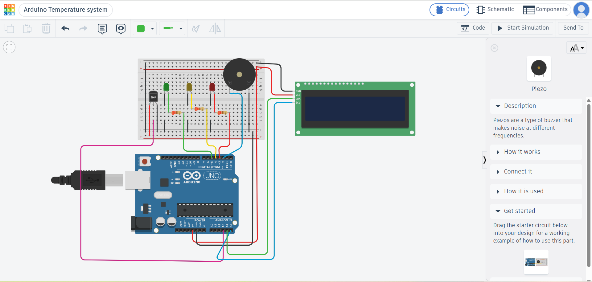
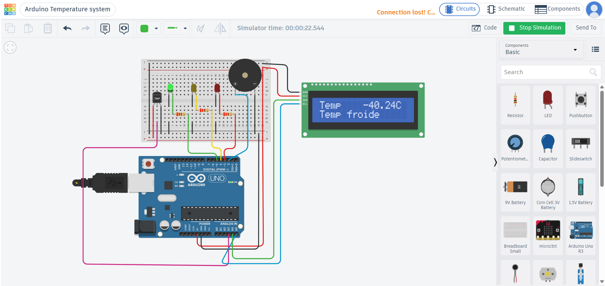

# Arduino Temperature Monitoring System

## Overview

This project is an Arduino-based temperature monitoring system designed to monitor temperature levels and provide visual and audible alerts. The system displays the measured temperature on a 16×2 LCD and uses three LEDs and a buzzer to indicate different temperature conditions.

The project was simulated using Tinkercad Circuits and also implemented with physical hardware available at school. While the Tinkercad simulation uses an analog temperature sensor, the physical implementation uses a DHT11 sensor, which can measure both temperature and humidity.

## Features

- Temperature measurement using a sensor
- Humidity measurement using a sensor in the physical implementation
- Temperature/humidity display on a 16×2 LCD
- Three LEDs to indicate different temperature conditions
- Buzzer alerts when the temperature is too low or too high
- Configurable temperature thresholds
- Circuit simulation using Tinkercad
- Physical implementation using Arduino hardware

## Temperature Thresholds

| Temperature | Status | LED Indicator | Buzzer |
| ≤ 16°C      | Cold   | Green         | ON     |
| 17–36°C     | Normal | Yellow        | OFF    |
| ≥ 37°C      | Alert  | Red           | ON     |

## Components

### Tinkercad Simulation

The circuit was designed and simulated using the following components:

- Arduino Uno R3
- Analog temperature sensor
- 16×2 LCD
- Red LED
- Yellow LED
- Green LED
- Piezo buzzer
- Resistors
- Jumper wires

**Note:** The DHT11 sensor was not available in Tinkercad. An available analog temperature sensor was therefore used for the simulation.

### Physical Implementation

The project was also built using the physical components available at school:

- Arduino Mega 2560 R3
- DHT11 temperature and humidity sensor
- 16×2 LCD (1602)
- Red, yellow, and green LEDs
- Buzzer
- Jumper wires

The DHT11 sensor was used in the physical implementation because it can measure both temperature and humidity.

## How It Works

The sensor provides temperature readings to the Arduino, which processes the measurements and displays the temperature on the LCD. The system then compares the measured temperature with predefined thresholds to determine the appropriate LED indicator and buzzer status.

- **Cold (≤ 16°C):** The green LED turns on and the buzzer is activated.
- **Normal (17–36°C):** The yellow LED turns on and the buzzer remains off.
- **Alert (≥ 37°C):** The red LED turns on and the buzzer is activated.

## Technologies Used

- Programming Language: C/C++ (Arduino)
- Development Environment: Arduino IDE
- Simulation Tool: Tinkercad Circuits

## Tinkercad Simulation

The circuit was designed and simulated in Tinkercad to test the temperature monitoring logic and the responses of the LEDs and buzzer.

**[View the project on Tinkercad](https://www.tinkercad.com/things/h0MGtyQLLRZ-arduino-temperature-system/editel?returnTo=https%3A%2F%2Fwww.tinkercad.com%2Fthings%2Fh0MGtyQLLRZ-arduino-temperature-system)**

### Simulation Screenshots

The following screenshots illustrate the circuit design and its behavior under different temperature conditions.

*Complete circuit design.*

*Normal temperature condition.*

*High-temperature alert condition.*

*low-temperature alert condition.*

## Physical Implementation

The project was also implemented using physical hardware available at school.

*Photograph of the physical implementation. The image quality is limited because the photograph was captured several months ago.*
## Author

**Nada Ferdouss**
